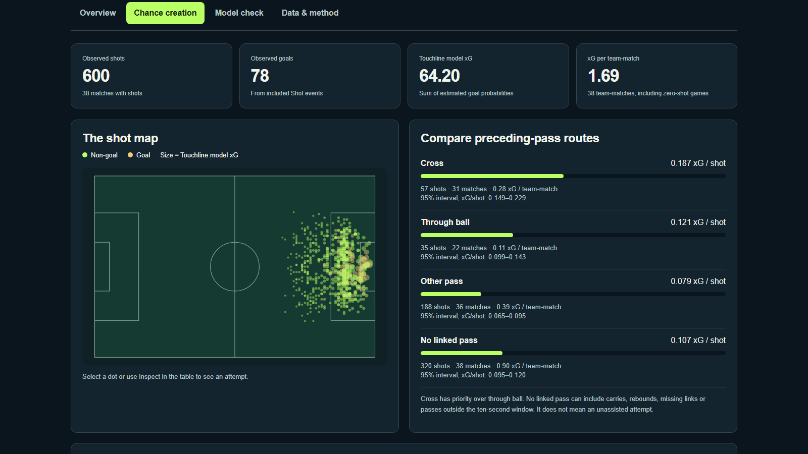
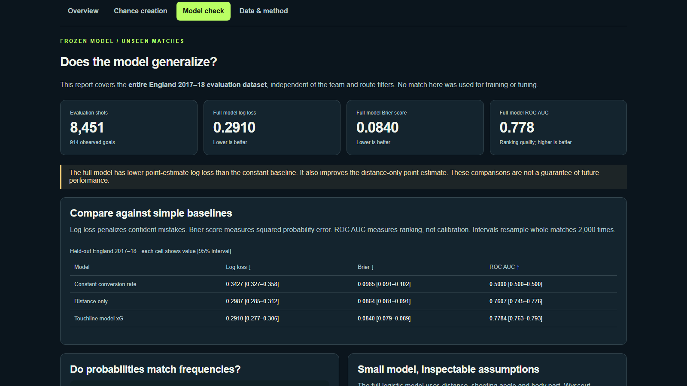

# Touchline

**Manage the club. Play the match. Understand the chances.**

A browser football sandbox with club and player careers, direct match control, private two-player drafting, recorded replays and real-match analytics. No account or installation is needed to play the public game.

[**Play Touchline**](https://touchline-draft-duel.aaravj117958.chatgpt.site/) · [**Open Analytics**](https://touchline-draft-duel.aaravj117958.chatgpt.site/analytics.html) · [**Challenge a friend**](https://touchline-draft-duel.aaravj117958.chatgpt.site/duel) · [Vercel edition](https://touchline-beta-ten.vercel.app/) · [Documentation](docs/README.md)


## What you can do

| Experience | Features |
| --- | --- |
| **Club management** | Prepare for opponents, select an XI, adjust tactics, explore transfers and finances, and progress through a season. |
| **Draft & Europe** | Reveal clubs and eras, choose natural-position players, build a squad and enter a European campaign. |
| **Direct play** | Move, pass, shoot, tackle and switch players with keyboard or touch controls; return to management or explicitly simulate to full-time. |
| **Player career & practice** | Develop a created player or repeat passing, shooting and defending exercises with device-saved progress. |
| **Recorded decisions** | Replay match commands and compare alternative simulated timelines. |
| **Draft Duel** | Invite a friend, alternate unique picks, choose hidden approaches, share one result, reconnect and request a mutual rematch. |
| **Real match analytics** | Filter historical shots, inspect source-linked maps, compare chance-creation routes and review independent shot-model evaluation. |

Solo progress stays on your device, with export and recovery tools in Settings. Offline preparation supports solo play and the bundled analysis. Shared multiplayer requires an internet connection.

## Real football data, independently evaluated

Analytics uses attributed **CC BY 4.0 Wyscout match events**, separately from the game simulation. A small logistic model uses shot distance, angle and body part. Development uses 32,010 shots from four leagues; England and the World Cup are held out from training and tuning.

| Evaluation data | Shots | Constant log loss | Distance-only log loss | Full-model log loss |
| --- | ---: | ---: | ---: | ---: |
| England 2017–18 | 8,451 | 0.3427 | 0.2987 | **0.2910** |
| World Cup 2018 | 1,377 | 0.3054 | 0.2627 | **0.2558** |

Lower log loss is better. The dashboard also shows Brier scores, calibration, sample sizes, uncertainty intervals from 2,000 whole-match bootstrap resamples and inconclusive findings. These are historical observational comparisons, not causal tactical effects or match-winner forecasts.

[Method and reproduction](docs/ANALYTICS.md) · [Verification and limitations](docs/ANALYTICS-VERIFICATION.md) · [Original dataset](https://figshare.com/collections/Soccer_match_event_dataset/4415000)

<details>
<summary>See the shot map and model report</summary>





</details>

## Run locally

Install **Node.js 24 or later**, then:

```sh
git clone https://github.com/aaravjj2/touchline.git
cd touchline
node server.mjs
```

Open **http://127.0.0.1:4173/**. Basic play, analytics and local Draft Duel use the committed source without a build step. For phone/LAN configuration and room persistence, see [multiplayer setup](docs/MULTIPLAYER.md). Local rooms are independent of the public Sites room service.

**Controls:** WASD/arrows move · J pass · L shoot · Q switch · Shift sprint · C tackle. Touch layouts expose on-screen controls.

## Develop and verify

```sh
npm install -g pnpm@11.25.0
pnpm install --frozen-lockfile
pnpm exec playwright install chromium
pnpm check
pnpm test
pnpm test:e2e
```

Run `pnpm build` after changing served assets to refresh the verified offline manifest. Browser tests run serially because they share local ports and some exercise rendered-match timing.

To reproduce the analysis in a dedicated **Python 3.12** environment:

```sh
python -m pip install -r scripts/analytics/requirements.txt
python scripts/analytics/build.py
python scripts/analytics/test_pipeline.py
```

Raw downloads are cached under ignored `work/`; source versions and SHA-256 checksums are pinned. No Python service, paid AI account or live inference is required by the published app.

Latest verification: **290 unit tests, 9 Python pipeline/audit tests, 21 focused browser regressions and 23 Sites checks** passed. A separate run reproduced all 453 analysis files byte-for-byte on the reference environment. These checks do not constitute a human usability study or physical-device certification. [Exact scope](docs/ANALYTICS-VERIFICATION.md).

## Repository map

| Path | Purpose |
| --- | --- |
| [`dist/`](dist/) | **Actual browser source and served assets**, including analytics. Intentionally committed; do not treat it as disposable build output. |
| [`api/`](api/) | Local Draft Duel service and optional inference adapter, disabled by default. |
| [`scripts/analytics/`](scripts/analytics/) | Reproducible data extraction, model training, source lock and audit tests. |
| [`scripts/media/`](scripts/media/) | Actual-app capture, non-generative cover/video assembly and draft-packet tooling. |
| [`tests/`](tests/) / [`browser-tests/`](browser-tests/) | Unit and browser regressions. |
| [`docs/`](docs/README.md) | Feature guides, release notes, verification and Devpost drafts. |
| [`hosting/sites/`](hosting/README.md) | Deployable mirror of the native Sites app, including Workers/D1 multiplayer. |
| [`data/`](data/README.md) / [`reports/`](reports/README.md) | Dated research and historical regression evidence, distinct from current runtime facts. |
| [`assets/`](assets/) | Source artwork and marketing assets; runtime assets live under `dist/`. |

The Vercel edition serves `dist/`. Its Multiplayer link opens the same shared Sites room service as the full Sites edition. [Deployment guide](docs/DEPLOYMENT.md) · [Script guide](scripts/README.md).

## Project history and licenses

Touchline is an existing project, with a disclosed foundation predating this public repository. ChatGPT and Codex assisted development, debugging, testing and documentation under human direction. See [contribution history](CONTRIBUTIONS.md); the [AQX Devpost project](https://devpost.com/software/touchline-analytics) remains a **draft, not an event submission**.

Application source is [MIT licensed](LICENSE). Analytics data retains CC BY 4.0 attribution; photographs, Three.js, fonts and animation assets retain their own notices. The cover above uses actual game rendering and typeset text, with no generative image model. This is an independent football prototype, not an officially licensed product or an authoritative contracts/valuation database. [Full asset and data credits](THIRD_PARTY_NOTICES.md).

[Release history](docs/releases/README.md) · [Earlier versioned demos](docs/DEMO.md) · [Contributing](CONTRIBUTING.md)
